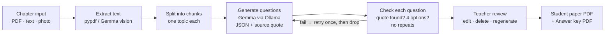

# Coaching Test Generator · प्रश्न पत्र

**Turn a chapter into a ready-to-print practice test in Hindi, English or both, with an answer key that shows where each answer comes from. It runs fully offline on your own laptop.**

Built for small coaching institutes and home tutors preparing students for **school boards, BPSC, SSC and Railway** exams. Upload a chapter PDF, photos of book pages, or your own notes. Pick how many questions you want. A few minutes later you have a student paper and an answer key to print.

> 🏁 Built for the DEV Hacktoberfest Open-Source AI Challenge, Week 2 — "Side Hustle". Uses **Gemma** running locally through Ollama.

<!-- TODO before publishing: add demo video link and screenshots


-->

---

## Why

- Writing 25 good questions for one chapter takes hours. Translating them for Hindi-medium students doubles the work.
- Paid question banks are generic and don't match **your** notes.
- Cloud AI tools charge per use, need good internet, and send your notes to someone else's server.

Coaching Test Generator runs an **open-weight Gemma model on your own laptop**. That means:

- **No per-question bill.** Running cost is close to zero, which is what makes ₹199/month pricing workable.
- **Your notes stay on your machine.**
- **Works without internet** once it is set up.

## Features

| | Feature | |
|---|---|---|
| 📄 | Chapter as **PDF**, **pasted text**, or **photos of book pages**. Gemma vision reads photos and scanned pages. | ✅ |
| ⚙️ | **5–50 questions**: **MCQ, true/false, fill in the blank, short answer**, at **easy / medium / hard** difficulty | ✅ |
| 🌐 | **Hindi**, **English**, or **bilingual** (both on one sheet, same answer letters) | ✅ |
| 📖 | Every question has its answer, a one-line explanation, and the **exact source sentence from your chapter** | ✅ |
| ✏️ | **Review screen**: edit, delete or regenerate any question. Export stays locked until you've reviewed them. | ✅ |
| 🖨️ | **Two PDFs**: a student paper (institute name, date, time, marks, name/roll line) and an answer key with source lines | ✅ |
| 🎯 | Exam style presets: Bihar Board, BPSC, SSC, Railway | Planned |
| 🔀 | Set A / Set B with shuffled order | Planned |
| 🗂️ | Question bank per chapter | Planned |
| 💬 | Word export and WhatsApp-friendly text quiz | Planned |

## How it works



**Accuracy matters more than quantity.** A wrong answer key costs a teacher credibility in front of students, so:

1. Gemma only sees one chunk of your chapter at a time, and is told to use only facts from it.
2. Each question must include the **exact sentence** from your chapter that proves its answer. Code checks that this sentence really appears in the chunk, using a fuzzy match that handles Hindi. Questions that fail are regenerated once, then dropped.
3. Code also checks that there are exactly 4 distinct options, that the answer is one of them, that there's no "all/none of the above" (उपरोक्त सभी / इनमें से कोई नहीं), that Hindi is really in Devanagari, that the Hindi and English versions match, and that there are no near-duplicate questions.
4. **You review every question before export.** The answer key prints the source line, so you can check each answer in seconds.

The app tells you what it kept, for example *"Kept 9 of 10 — dropped: 1 source not found in chapter"*.

Design docs: **[High-Level Design](docs/HLD.md)** · **[Low-Level Design](docs/LLD.md)**

## Quick start

### Requirements

- A laptop with **8 GB RAM or more** (16 GB is better). No GPU needed. Close heavy apps such as Chrome while generating.
- **Python 3.11+** and **[Ollama](https://ollama.com/download)**. The setup scripts install or check both.

### One-command setup

**Linux / macOS**

```bash
git clone https://github.com/ThePlator/Coaching_Test_Generator-.git
```

```bash
cd Coaching_Test_Generator-
```

```bash
bash scripts/setup.sh
```

**Windows (PowerShell)**

```powershell
powershell -ExecutionPolicy Bypass -File scripts\setup.ps1
```

The script creates `.venv`, installs packages, installs Ollama if you agree, downloads **gemma3:4b** (about 3 GB, one time), creates `config/institute.toml`, and runs a preflight check. On Windows, PDFs are made with Chromium (installed by the script), because WeasyPrint's GTK libraries are hard to install there.

<details>
<summary>Manual setup</summary>

```bash
python3 -m venv .venv
```

```bash
.venv/bin/pip install -r requirements.txt
```

```bash
ollama pull gemma3:4b
```

On Linux, PDF export needs Pango (`sudo apt install libpango-1.0-0 libpangoft2-1.0-0`). On macOS, run `brew install pango`.
</details>

### Run

```bash
ollama serve
```

In a second terminal:

```bash
.venv/bin/streamlit run app.py
```

Open http://localhost:8501. After setup, nothing needs the internet.

## Using it

1. **Sidebar:** set your institute's name (English and हिंदी), the usual time and marks per question. A green light means Gemma is ready.
2. **Chapter:** upload a PDF, add photos of the pages, or paste your notes. Try `samples/sample_chapter.txt` first.
3. **Settings:** number of questions (10 is the default), types, difficulty, language. Then click **Generate**.
4. **Review:** check each question, its ✅ answer and 📖 source line. ⚠️ marks things worth a second look. Edit, delete or regenerate as needed, then tick *"I have reviewed all questions"*.
5. **Print:** set the title, date, time and marks, then download the **student paper** and **answer key**. Copies are saved in `outputs/<date>_<title>/`.

**Tips**

- Text PDFs and pasted notes are faster and more accurate than photos. If you use photos, take them flat, in good light, one page per photo.
- On a laptop without a GPU, start with 10–15 questions.
- Text-based subjects work best: GK, history, polity, science theory, English, Hindi. Maths with diagrams isn't supported yet.

## Check your setup

```bash
.venv/bin/python scripts/preflight.py --warm
```

This checks packages, fonts, free memory, your institute profile and Ollama. It renders a Hindi test PDF for you to inspect, loads Gemma, and times a small test so you know how long a 10-question test will take on your laptop.

## Command line

The same pipeline, without the UI:

```bash
.venv/bin/python scripts/cli.py samples/sample_chapter.txt -n 10 --mode bilingual --out test.json
```

It accepts a PDF, a text file, or several photos. Use `--types mcq true_false` and `--difficulty easy` to change the defaults.

## Configuration

Settings come from environment variables (prefix `CTG_`, or a `.env` file):

| Variable | Default | Meaning |
|---|---|---|
| `CTG_MODEL` | `gemma3:4b` | Model for questions and photo reading (must support vision for photos) |
| `CTG_TEXT_MODEL` | *(unset)* | Optional smaller model for text-only input, e.g. `gemma3:1b` |
| `CTG_OLLAMA_HOST` | `http://localhost:11434` | Ollama server |
| `CTG_TEMPERATURE` | `0.4` | Lower values are more conservative |
| `CTG_NUM_CTX` | `4096` | Model context size |
| `CTG_REQUEST_TIMEOUT_S` | `180` | Per-call timeout |
| `CTG_QUOTE_MATCH_THRESHOLD` | `90` | How closely the source quote must match the chapter (0–100) |
| `CTG_OUTPUTS_DIR` | `outputs/` | Where PDFs are saved |

Your institute profile lives in `config/institute.toml`. Edit it from the app sidebar.

## Project structure

```
app.py                 Streamlit UI
ctg/
  config.py            settings + institute profile
  models.py            data models
  llm.py               Ollama client (+ fake for tests)
  ingest.py            PDF / photo / text → text (vision OCR for scans)
  chunker.py           split chapter, spread questions across chunks
  prompts.py, schema.py  generation rules, few-shot Hindi, JSON schema
  generator.py         calls Gemma per chunk
  validate.py          source-quote check, option rules, dedupe
  pipeline.py          retry-once-then-drop orchestration, regenerate one
  session.py           first-user session timings (counts only)
  export/              HTML templates → PDF (Noto Sans Devanagari)
scripts/               setup.sh / setup.ps1, preflight, cli, spikes
assets/fonts/          bundled Noto fonts (SIL OFL)
samples/               sample chapters written for this repo (free to share)
tests/                 pytest suite — uses a fake model, no Ollama needed
docs/                  HLD, LLD, spike results, first-user notes
```

## Development

```bash
.venv/bin/pip install -r requirements-dev.txt
```

```bash
.venv/bin/pytest -q
```

The tests use a fake model that writes questions from real sentences in the chunk, so they run in seconds without Ollama. To try prompt changes against the real model, use `scripts/spike_gen.py`.

## Privacy and content

- Uploaded chapters are kept **in memory only** and never leave your laptop.
- The app makes no network calls except to your local Ollama, and Streamlit usage stats are off. Logs hold counts and timings, never chapter text.
- Only use chapters and notes you are allowed to use. The sample chapters in this repo were written for it. No textbook content is included.

## Limitations

- Text-based subjects only for now. No diagrams or long maths derivations.
- No online exams, student logins or auto-grading.
- Speed depends on your laptop. On CPU-only machines, keep tests to 10–15 questions.
- A small model still makes mistakes. That's why review is required and the key shows the source line.

## Roadmap

- [ ] Exam style presets (Bihar Board, BPSC, SSC, Railway)
- [ ] Set A / Set B shuffling
- [ ] Question bank per chapter
- [ ] Word export and WhatsApp text quiz

## Contributing

Issues and PRs are welcome, especially:

- exam-style Hindi few-shot examples (`ctg/prompts.py`)
- better OCR for low-quality photos
- new exam presets

Please don't commit copyrighted textbook content.

## License

[MIT](LICENSE). Bundled Noto fonts © Google, [SIL Open Font License 1.1](assets/fonts/OFL.txt).
