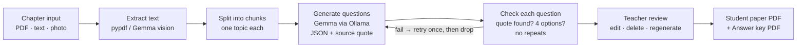

# Coaching Test Generator · प्रश्न पत्र

**Turn a chapter into a ready-to-print practice test in Hindi, English or both, with an answer key that shows where each answer comes from. It runs fully offline on your own laptop.**

Built for small coaching institutes and home tutors preparing students for **school boards, BPSC, SSC and Railway** exams. Upload a chapter PDF, a photo of a book page, or your own notes. Pick how many questions you want. In a few minutes you get a student paper and an answer key, ready to print.

> 🏁 Built for the DEV Hacktoberfest Open-Source AI Challenge, Week 2 — "Side Hustle".

---

## Why

- Writing 25 good questions for one chapter takes hours. Translating them for Hindi-medium students doubles the work.
- Paid question banks are generic and don't match **your** notes.
- Cloud AI tools charge per use, need good internet, and send your notes to someone else's server.

Coaching Test Generator uses an **open-weight Gemma model running on your laptop through Ollama**. That means:

- **No per-question bill.** Running cost is close to zero.
- **Your notes stay on your machine.**
- **Works without internet** once it is set up.

## Features

| | Feature | Status |
|---|---|---|
| 📄 | Upload a chapter as **PDF**, **pasted text**, or **photos of book pages** (Gemma vision reads them) | MVP |
| ⚙️ | Choose **5–50 questions**, types (**MCQ, true/false, fill in the blank, short answer**), difficulty (**easy / medium / hard**) | MVP |
| 🌐 | Language: **Hindi**, **English**, or **bilingual** (both on one sheet) | MVP |
| ✅ | Every question comes with its answer, a one-line explanation, and the **source sentence from your chapter** | MVP |
| ✏️ | **Review screen**: edit, delete or regenerate any single question before printing | MVP |
| 🖨️ | Export **two PDFs**: a student paper (institute name, date, marks, time) and an answer key | MVP |
| 🎯 | Exam style presets: Bihar Board, BPSC, SSC, Railway | Planned (P1) |
| 🔀 | Set A / Set B with shuffled order | Planned (P1) |
| 🗂️ | Save a question bank per chapter | Planned (P1) |
| 💬 | Word export and WhatsApp-friendly text quiz | Planned (P2) |

## How it works



**Accuracy matters more than quantity.** A wrong answer key costs a teacher credibility in front of students, so:

1. The model may only use facts from the chunk it was given.
2. Each question must include the **exact sentence** from your chapter that proves its answer. Code checks that this sentence really is in the chapter, and questions that fail are regenerated once or dropped.
3. Code also checks for exactly 4 distinct options, the answer being one of them, no near-duplicate questions, and matching answers in Hindi and English.
4. **You review every question before export.** The app never prints anything you haven't seen, and the answer key shows the source line so you can check each answer in seconds.

The app tells you how many questions were kept, for example *"Kept 12 of 15: 2 source not found, 1 duplicate"*.

## Quick start

### 1. Requirements

- A laptop with **8 GB RAM or more** (16 GB recommended). A GPU is optional.
- **Python 3.11+**
- **[Ollama](https://ollama.com/download)**

### 2. Install the model (one time, about 3 GB download)

```bash
ollama pull gemma3:4b
```

### 3. Install the app

```bash
git clone https://github.com/<your-username>/coaching-test-generator.git
```

```bash
cd coaching-test-generator
```

```bash
python -m venv .venv && source .venv/bin/activate
```

```bash
pip install -r requirements.txt
```

> **Windows:** PDF export uses WeasyPrint, which needs the GTK runtime. Run `scripts/setup.ps1`, which installs it for you. On Linux and macOS, `scripts/setup.sh` installs the system packages (Pango).

### 4. Run

```bash
ollama serve
```

In a second terminal:

```bash
streamlit run app.py
```

Open http://localhost:8501. After this first setup, no internet connection is needed.

## Using it

1. **Chapter:** upload a PDF, add photos of the pages, or paste your notes. Try `samples/` first.
2. **Settings:** number of questions (10 is the default), types, difficulty, language.
3. **Generate:** watch the progress bar as each part of the chapter is processed.
4. **Review:** read each question with its answer and source line, then edit, delete or regenerate as needed. Tick *"I have reviewed all questions"*.
5. **Export:** enter the test title, date, time and marks per question, then download the **student paper** and **answer key** PDFs.

**Tips**

- Text PDFs and pasted notes are faster and more accurate than photos. If you use photos, take them flat, in good light, one page per photo.
- On a slower laptop, start with 10–15 questions.
- Best results come from text-based subjects: GK, history, polity, science theory, English, Hindi. Maths with diagrams is not supported yet.

## Configuration

Settings come from environment variables (prefix `CTG_`) and `config/institute.toml`.

| Variable | Default | Meaning |
|---|---|---|
| `CTG_OLLAMA_HOST` | `http://localhost:11434` | Ollama server |
| `CTG_MODEL` | `gemma3:4b` | Model used for generation and photo reading (must support vision for photos) |
| `CTG_TEXT_MODEL` | *(unset)* | Optional smaller, faster model for text-only input, e.g. `gemma3:1b` |
| `CTG_NUM_CTX` | `4096` | Model context size |
| `CTG_TEMPERATURE` | `0.4` | Lower values are more conservative |
| `CTG_OUTPUTS_DIR` | `outputs` | Where exported PDFs are saved |

Copy `config/institute.example.toml` to `config/institute.toml` and set your institute name (English and Hindi), default time and marks per question.

## Project structure

```
app.py               Streamlit UI
ctg/                 core package
  ingest.py          PDF / photo / text → text
  chunker.py         split chapter, spread questions across chunks
  prompts.py         generation rules, exam-style examples
  generator.py       calls Gemma via Ollama (JSON-schema output)
  validate.py        source-quote check, option rules, dedupe
  pipeline.py        retry-once-then-drop orchestration
  export/            HTML templates → PDF (Noto Sans Devanagari)
assets/fonts/        bundled Noto fonts (SIL OFL)
samples/             shareable sample chapter
tests/               pytest suite (uses a fake LLM, no Ollama needed)
docs/                HLD.md, LLD.md
```

Design docs: **[High-Level Design](docs/HLD.md)** · **[Low-Level Design](docs/LLD.md)**

## Development

```bash
pip install -r requirements.txt pytest hypothesis
```

```bash
pytest
```

The tests use a fake model client, so they run without Ollama. To measure real speed on your machine:

```bash
python scripts/bench.py samples/sample_chapter.pdf
```

## Privacy and content

- Uploaded chapters are kept **in memory only** and are never sent anywhere outside your laptop.
- The app makes no network calls other than to your local Ollama server, and Streamlit usage stats are turned off.
- Only use chapters and notes you are allowed to use. This repo includes only a sample chapter that may be shared, not textbook content.

## Limitations

- Text-based subjects only for now. No diagrams or long maths derivations.
- No online exams, student logins or auto-grading.
- Speed depends on your laptop. On CPU-only machines, keep tests to 10–15 questions.
- Questions from a small model still need a teacher's eye. That is why the review step is required.

## Roadmap

- [ ] Exam style presets (Bihar Board, BPSC, SSC, Railway)
- [ ] Set A / Set B shuffling
- [ ] Question bank per chapter
- [ ] Word export and WhatsApp text quiz
- [ ] One-click installer for Windows

## Contributing

Issues and PRs are welcome, especially:

- exam-style Hindi few-shot examples
- better OCR handling for low-quality photos
- new exam presets

Please don't commit copyrighted textbook content.

## License

[MIT](LICENSE). Bundled Noto fonts are under the SIL Open Font License.
