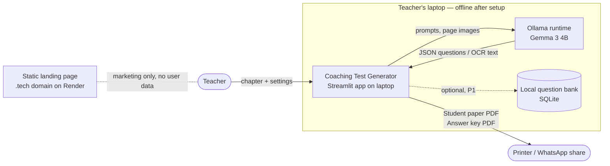
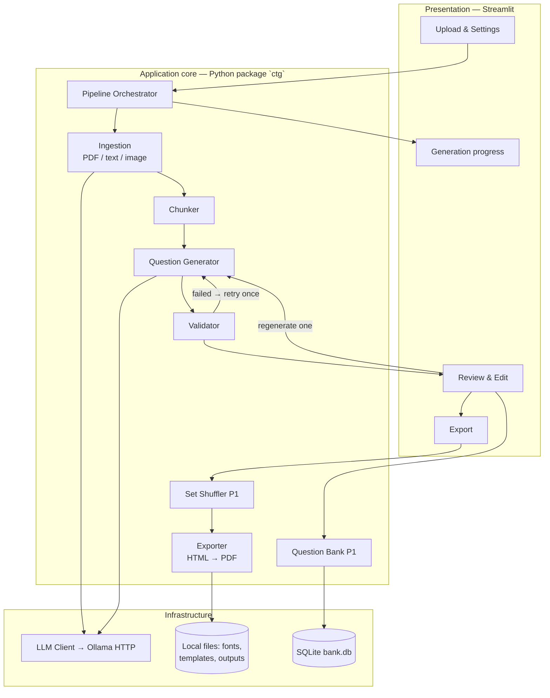
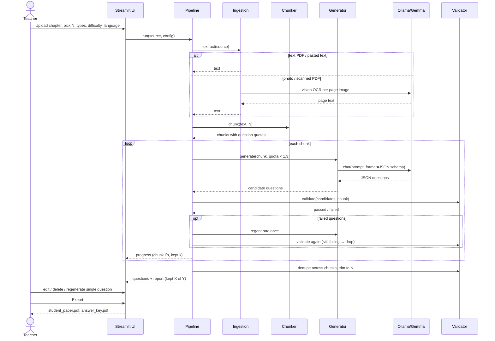
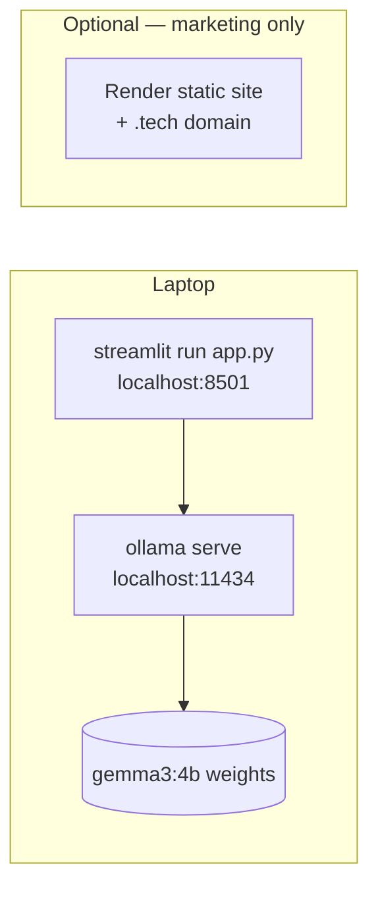

# Coaching Test Generator — High-Level Design (HLD)

| | |
|---|---|
| **Status** | Draft v1 — 17 Oct 2026 |
| **Source** | Coaching Test Generator — PRD (17 Oct 2026) |
| **Working name** | Coaching Test Generator ("Prashn Patra") |
| **Deadline** | Mon 19 Oct 2026, 12:29 PM IST |

---

## 1. Purpose

This document turns the PRD into a system architecture: the main components, how data moves between them, where it is stored, and the design decisions behind them. Module APIs, data schemas, prompts and algorithms are in the [LLD](LLD.md).

## 2. Context

A teacher at a small coaching institute in Patna uploads a chapter (PDF, pasted notes or a photo of a book page). The system produces a printable practice test in Hindi, English or bilingual form, with an answer key in which each answer points to its source sentence. Everything runs on the institute's own laptop with a local Gemma model:

- **No per-question cost.** This is what makes ₹199 and ₹999 per month workable.
- **Notes stay private.** Nothing leaves the laptop.
- **Works offline** once setup is done.

## 3. Goals that drive the architecture

| PRD goal | What it means for the architecture |
|---|---|
| G1: chapter to printable test in under 5 min | The pipeline works one chunk at a time with a progress bar. The default is 10–15 questions, and the smallest Gemma model that works is used. Several questions are generated per LLM call. |
| G2: every question answerable from the chapter | Each question is grounded in one chunk. It must include a `source_quote`, which code checks against the chunk with a fuzzy match. Questions that fail are retried once, then dropped. |
| G3: Hindi / English / bilingual | Hindi and English are generated **together in one call**, so they share one answer index. The PDF renderer must shape Devanagari correctly. |
| G4: fully offline | Local model through Ollama, bundled fonts, no CDN assets, no telemetry. |
| G5: a real teacher uses it | A simple single-page flow (upload → settings → generate → review → export), and the teacher always reviews before export. |

**Non-goals (this release):** online exams, student logins, auto-grading, maths with diagrams or long derivations, in-app payments, a mobile app.

## 4. Architecture overview

The system is a **single-process local application** with these layers:

### 4.1 Components

| # | Component | Responsibility | Key tech |
|---|---|---|---|
| C1 | **Streamlit UI** | Upload, settings form, progress, review/edit table, export buttons. Holds session state. | Streamlit |
| C2 | **Ingestion** | Turns any input into clean Unicode text. Text PDFs go through `pypdf`. Photos and scanned pages go through Gemma vision OCR. Pasted text is used as is. | pypdf, pypdfium2 (page render), Pillow |
| C3 | **Chunker** | Splits text into topic-sized, paragraph-aligned chunks (~1,500 chars) and spreads the requested question count across them. | Pure Python |
| C4 | **Question Generator** | Builds the prompt for each chunk (rules + exam style + language + types) and calls Gemma with a JSON-schema-constrained output. | Ollama structured outputs |
| C5 | **Validator** | Pydantic schema check, source-quote fuzzy match, option rules, answer-in-options, bilingual consistency, near-duplicate removal. | Pydantic v2, rapidfuzz |
| C6 | **Pipeline Orchestrator** | Runs C2→C5 and handles retry-once-then-drop. Reports progress and a kept/dropped summary. | Python generator / callbacks |
| C7 | **Exporter** | Renders the student paper and answer key from HTML templates to PDF with an embedded Noto Sans Devanagari font. | Jinja2 + WeasyPrint |
| C8 | **Set Shuffler (P1)** | Builds Set A / Set B by reordering questions and options from a seed, with an answer key per set. | Pure Python |
| C9 | **Question Bank (P1)** | Saves reviewed questions per chapter for reuse. | SQLite (stdlib `sqlite3`) |
| C10 | **LLM Client** | Thin wrapper over the Ollama HTTP API: chat, vision, timeouts, health check. Can be swapped for a fake in tests. | `ollama` Python lib / httpx |

## 5. Main flows

### 5.1 Generate a test (happy path)

### 5.2 Regenerate one question (review screen)

The teacher clicks **Regenerate** on question *q*. The orchestrator takes *q*'s chunk, sends the other questions' stems as "do not repeat", asks for 1 question of the same type, difficulty and language, and validates it. If it passes, it replaces *q*. If it fails twice, the old question stays and the teacher sees a warning.

### 5.3 Export

The teacher clicks **Export**. The UI blocks export until the review screen has been shown, so the app never prints questions the teacher hasn't seen. If P1 is enabled, the shuffler makes the sets. The exporter renders `paper.html.j2` and `key.html.j2` to PDF, and the files are offered as downloads and saved under `outputs/<date>_<chapter>/`.

## 6. Data and storage

| Data | Where it lives | Lifetime |
|---|---|---|
| Uploaded chapter, extracted text, chunks | Streamlit session memory | Session only. Never written to disk unless saved to the bank. |
| Generated questions | Session memory, then the question bank (P1) | Session / until deleted |
| Exported PDFs | `outputs/` on the laptop | Until the teacher deletes them |
| Institute profile (name, default marks/time) | `config/institute.toml` | Persistent |
| Question bank (P1) | `data/bank.db` (SQLite) | Persistent |
| Model weights | Ollama model store | Persistent |

Core entities (full schema in the LLD): `SourceDocument → Chunk → Question`, `TestConfig`, `Test`, `GenerationReport`.

## 7. Key design decisions

| # | Decision | Alternatives considered | Rationale |
|---|---|---|---|
| D1 | **Local Gemma through Ollama** (`gemma3:4b` by default, configurable) | Cloud APIs; llama.cpp directly | Offline, private, free to run, and it qualifies for "Best Use of Gemma". Ollama gives one-command install, vision support and JSON-schema structured output. |
| D2 | **Chunk-grounded generation**, one chunk per call | Whole chapter in one prompt | A small model with a small context hallucinates less when the context is narrow. It also gives each question one chunk to be checked against. |
| D3 | **Structured output (JSON schema in `format`) plus a Pydantic check** | Free-text parsing | Removes most broken-JSON failures at the source. Pydantic catches whatever still gets through. |
| D4 | **Code checks `source_quote` against the chunk** | Trusting the model; an LLM judge | Cheap, deterministic, explainable to the teacher, and the PRD asks for it. An LLM judge would double latency on CPU. |
| D5 | **Bilingual = one call returning both languages** | Generate in English, then translate | Same answer index by construction (PRD check). PRD rule 5 asks for exam-style Hindi, not literal translation. Fewer calls. |
| D6 | **HTML → PDF with WeasyPrint** and an embedded Noto Sans Devanagari | reportlab | ReportLab's default text drawing does not apply the OpenType shaping that Devanagari needs (conjuncts, matra reordering), so Hindi can come out broken (PRD risk "Hindi text breaks in the PDF"). WeasyPrint shapes text with HarfBuzz through Pango. Fallback: headless Chromium print-to-PDF. |
| D7 | **Retry once, then drop**, and tell the teacher how many were kept | Unlimited retries | Keeps total time bounded (G1) and is honest with the teacher. |
| D8 | **Over-generate ×1.3 per chunk** | Generate exactly N | Makes up for dropped questions so the teacher usually gets N without extra rounds. |
| D9 | **Single process, no backend server** | FastAPI + frontend | 40-hour build window. Streamlit gives upload, review and edit on one page. |
| D10 | **SQLite for the bank (P1)** | JSON files | Built into the stdlib, has queries and works offline. |

## 8. Quality and accuracy design

There are three layers of protection against wrong answer keys:

1. **Prompt rules**: only facts from the chunk; exactly one correct option; plausible distractors; `source_quote` required; no "all/none of the above" unless allowed; natural exam Hindi.
2. **Code checks**: schema valid; `source_quote` fuzzy-matches the chunk; 4 distinct options with the answer among them; bilingual answer letters match; near-duplicates removed.
3. **Human in the loop**: review is required before export, and the answer key prints the source line so the teacher can check each answer in seconds.

## 9. Non-functional requirements

| Area | Target / approach |
|---|---|
| **Latency** | Default test (10–15 Q) under 5 minutes on a typical 8–16 GB RAM laptop CPU. Mitigations: smallest Gemma, several questions per call, short prompts, `num_ctx` capped at 4096, streaming progress. Benchmark on day 1. |
| **Hardware** | 8 GB RAM minimum for `gemma3:4b` (quantised). A GPU is optional. `gemma3:1b` is a fallback for text only (no vision). |
| **Offline** | No network calls except to `localhost:11434`. Fonts and templates are bundled. Streamlit usage stats are turned off. |
| **Privacy** | Uploads stay in memory. No telemetry. The repo includes only a sample chapter that may be shared. |
| **Reliability** | Ollama health check at startup with a clear "Start Ollama" message. Per-call timeout. Errors in one chunk do not stop the run. |
| **Usability** | One page, Hindi/English UI labels, sensible defaults (10 Q, MCQ, medium, bilingual). |
| **Portability** | Linux / Windows / macOS. On Windows, WeasyPrint needs the GTK runtime, so the setup script installs it. The one-time-setup plan covers this. |
| **Testability** | The LLM client sits behind an interface, so the pipeline can be tested with a fake model. Validators are pure functions. |

## 10. Deployment

- **Primary:** run locally. Setup is `install Ollama → ollama pull gemma3:4b → pip install -r requirements.txt → streamlit run app.py`. A `setup.sh` / `setup.ps1` script does this for the ₹1,500 install plan.
- **Optional demo:** a static landing page on Render with a .tech domain, showing sample outputs and the demo video. It does **not** run Gemma, because the free tier lacks the RAM and real use stays on the laptop.

## 11. Risks (architecture view)

| Risk | Architectural mitigation |
|---|---|
| Wrong or made-up answers | D2, D4, required review, source line in the key |
| Weak Hindi | D5. Few-shot exam-style Hindi examples in the prompt. The teacher can edit. |
| Scanned PDFs have no text layer | Ingestion detects pages with little text and sends them to vision OCR |
| Slow on CPU | D7, D8, chunk-level progress, a smaller model as an option |
| Devanagari breaks in the PDF | D6. A golden-file export test with Hindi conjuncts on day 1. |
| Ollama not running / model missing | Startup health check and a clear fix-it message |
| Textbook copyright | Repo ships only a shareable sample. Uploads are never persisted by default. |

## 12. Release scope

| Release | Features |
|---|---|
| **MVP (Mon morning)** | F1–F6: upload (PDF / text / photo), settings, language, generation with checks, review/edit/regenerate, two PDFs |
| **P1 (if P0 is done by Sun afternoon)** | F7 exam presets, F8 Set A/B shuffle, F9 question bank |
| **P2** | F10 Word export, WhatsApp text quiz |

## 13. Open questions

- First user: which teacher or institute? (This affects default subject and exam preset.)
- First subjects: GK/polity, science theory or language?
- Final product name: "Prashn Patra" or something else?
- Is `gemma3:4b` fast enough on the first user's actual laptop? If not, fall back to a smaller model plus fewer questions.
